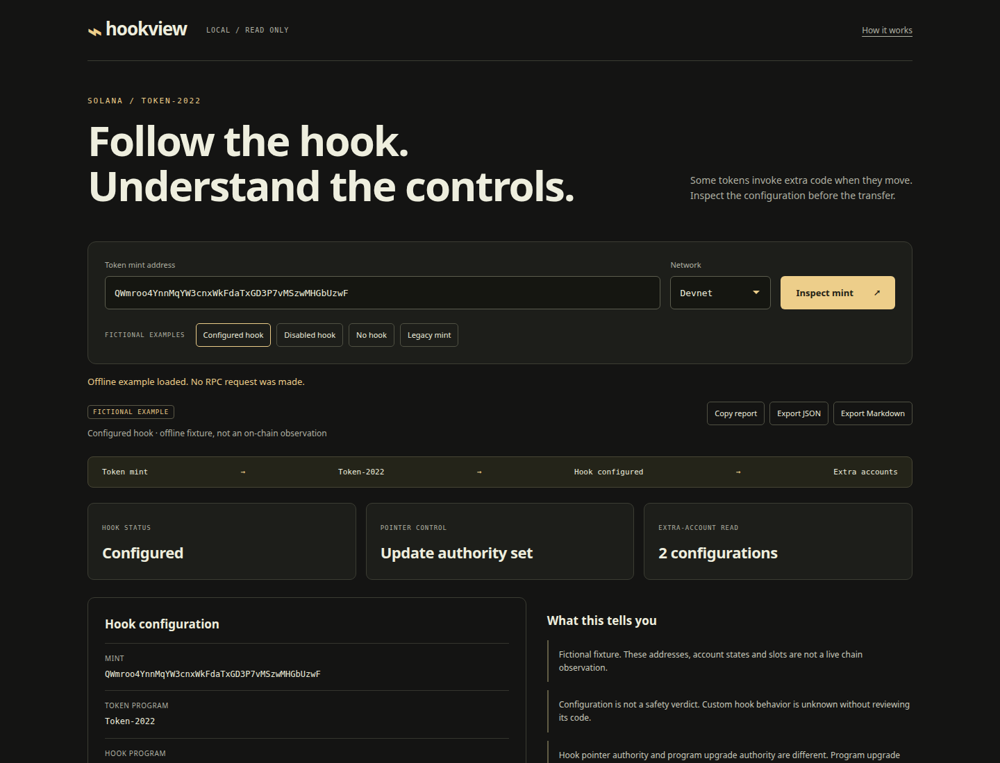

# hookview

See which extra program logic a Solana token transfer may invoke.



[](https://github.com/royalpinto007/hookview/actions/workflows/ci.yml)
[MIT](LICENSE) · [Architecture](docs/architecture.md) · [Reading the report](docs/guide.md)

```sh
npx hookview
```

Open **http://127.0.0.1:4470**. Node.js 22.18+ required.

- Inspect Mainnet and Devnet token mints through free public RPC.
- Read the TransferHook program and its pointer update authority.
- Check whether the program account is executable.
- Inspect the optional extra-account PDA, configurations and requested permissions.
- Try offline examples; copy or export JSON and Markdown reports.

**Configuration is not a safety verdict.** Custom program behavior, program upgrade authority and transfer-specific dynamic addresses remain unverified. No wallet, signatures or transactions.

### CLI

```sh
npx hookview So11111111111111111111111111111111111111112 --network mainnet --json
npx hookview --example configured --json
npx hookview --port 4475
```

The wrapped SOL example is a legacy mint, so it has no Token-2022 transfer hook. `--example` uses fictional data without RPC. Exit `0`: report produced, including clearly labelled partial reads. Exit `1`: lookup failed. Exit `2`: usage or server error.

### From source

```sh
git clone https://github.com/royalpinto007/hookview.git
cd hookview
npm install
npm run demo
```

Run `npm run check`, `npm run test:e2e` and `npm run package:check` before contributing.

No database, cloud service or saved history. Live lookups contact public Solana RPC and are subject to rate limits. Only explicit exports save files. The dashboard binds to loopback.
