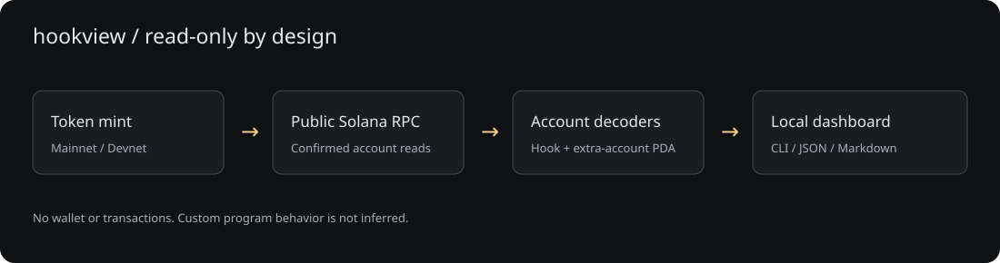
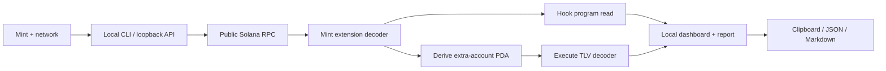

# Architecture

The RPC adapter validates bounded JSON/base64 responses. Pure binary decoders interpret the mint and extra-account layouts. The inspection service composes observations and preserves partial failures as explicit unknowns. The same report formatter serves the CLI and browser.

The browser only contacts its local server. No arbitrary RPC URL input, program execution, signing, telemetry or database is included. A packaged fictional reader exercises the same decoder path without network calls.
